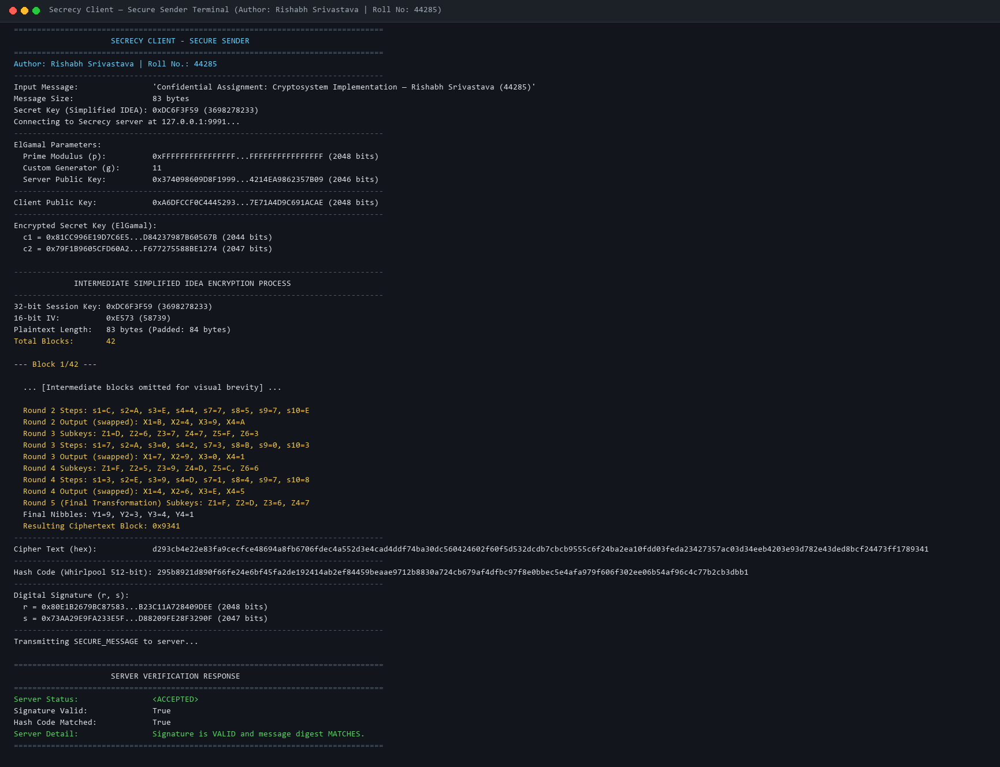
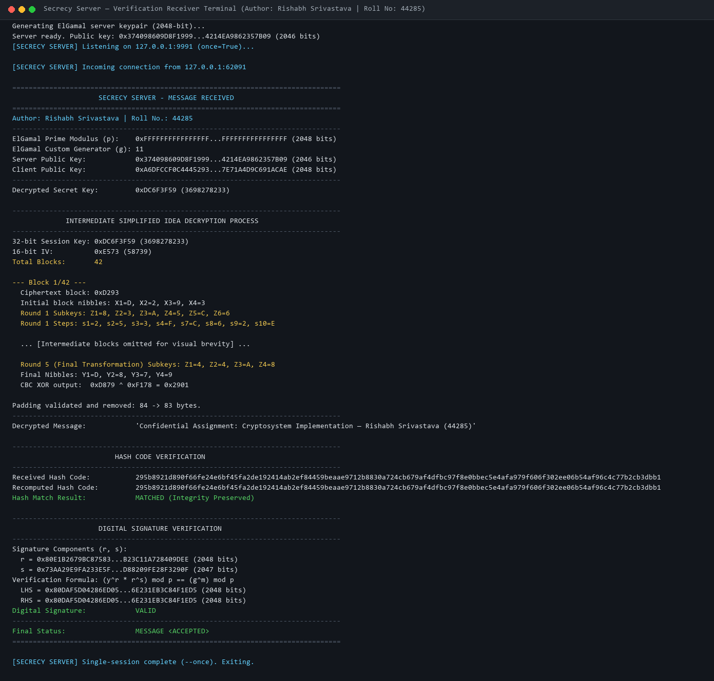
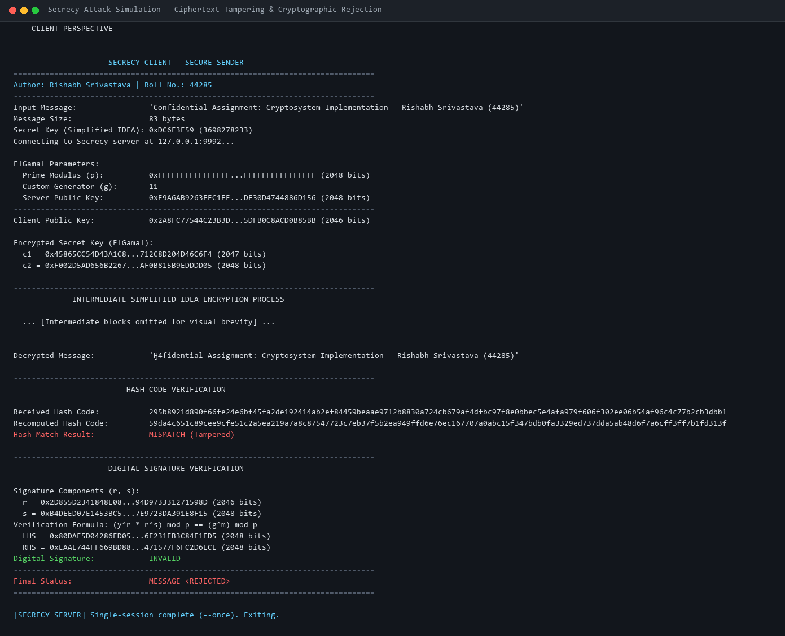

# Secrecy — Secure Client-Server Message Exchange Cryptosystem

**Author:** Rishabh Srivastava
**Roll Number:** 44285
**Institution:** Indian Institute of Information Technology (IIIT)
**GitHub Repository:** [https://github.com/RISHABHXVAZ/Secrecy.git](https://github.com/RISHABHXVAZ/Secrecy.git)
**Default Branch:** `main`

---

## 1. Executive Summary & Algorithm Assignment

**Secrecy** is an end-to-end, cross-platform command-line client–server cryptographic message exchange system developed from first principles in pure Python (standard library only). The project strictly implements the cryptographic primitives assigned to **Roll Number 44285**:

$$\text{Roll No.} = 44285$$

1. **Symmetric Message Encryption:**
   $$44285 \pmod 3 = 2 \implies \mathbf{Simplified\ IDEA}$$
2. **Asymmetric Key Exchange & Digital Signatures:**
   $$44285 \pmod 2 = 1 \implies \mathbf{ElGamal}$$
3. **Cryptographic Hash Function:**
   $$\mathbf{Whirlpool}\text{ (ISO/IEC 10118-3:2004, built 100\% from scratch)}$$

### Zero Third-Party Cryptography Policy
No third-party cryptographic libraries (`pycryptodome`, `cryptography`, `hashlib.whirlpool`, etc.) are used for any algorithm in this project. All block cipher transformations, modular arithmetic, key schedules, digital signature mathematics, and hash compressions are implemented directly from official mathematical specifications and vetted standards.

---

## 2. Mathematical Formulations & Cryptographic Architecture

### 2.1 Simplified IDEA (International Data Encryption Algorithm)
Based on Nick Hoffman's specification (*Northern Kentucky University*):
* **Plaintext / Ciphertext Block Size:** 16 bits (divided into four 4-bit nibbles: $X_1, X_2, X_3, X_4$).
* **Symmetric Key Size:** 32 bits (divided into eight 4-bit nibbles: $Z_1, \dots, Z_8$).
* **Rounds:** 4 complete identical rounds plus 1 final half-round output transformation.
* **Key Schedule:** Generates twenty-eight 4-bit subkeys via successive 6-bit cyclic left shifts:
  $$\text{Key}^{(k+1)} = \text{ROL}_{32}(\text{Key}^{(k)}, 6)$$
* **Algebraic Operations on 4-bit Nibbles:**
  1. Bitwise Exclusive-OR: $\oplus$
  2. Addition modulo $2^4 = 16$: $\boxplus$ (with additive inverse $\boxminus a = (-a) \bmod 16$)
  3. Multiplication modulo $2^4 + 1 = 17$: $\odot$, where $0000_2$ represents integer $16 \equiv -1 \pmod{17}$, and results congruent to $16$ are encoded as $0000_2$. Multiplicative inverses satisfy $(a \cdot a^{-1}) \equiv 1 \pmod{17}$.
* **Decryption Schedule:** Derived through algebraic inversion and round reversal of encryption subkeys:
  * Round 1: $(Z_1^5)^{-1}, -Z_2^5, -Z_3^5, (Z_4^5)^{-1}, Z_5^4, Z_6^4$
  * Rounds $r \in \{2, 3, 4\}$ (with $\text{enc\_r} = 6 - r$): $(Z_1^{\text{enc\_r}})^{-1}, -Z_2^{\text{enc\_r}}, -Z_3^{\text{enc\_r}}, (Z_4^{\text{enc\_r}})^{-1}, Z_5^{\text{enc\_r}-1}, Z_6^{\text{enc\_r}-1}$
  * Final Half-Round: $(Z_1^1)^{-1}, -Z_2^1, -Z_3^1, (Z_4^1)^{-1}$
* **Operating Mode:** Cipher Block Chaining (CBC) with a randomly sampled 16-bit Initialization Vector ($IV$) and 2-byte PKCS#7 block padding.

### 2.2 ElGamal Asymmetric Cryptosystem
* **Domain Parameters:**
  * Modulus: RFC 3526 MODP Group 14 2048-bit safe prime $p$, where $q = \frac{p - 1}{2}$ is also prime ($p > 2^{2047}$).
  * Generator: Custom full-order generator $g = 11$, with multiplicative group order $\text{ord}(11) = p - 1 = 2q$. (Documented distinction: standard RFC 3526 specifies $g = 2$, which generates the prime-order subgroup of order $q$).
* **Key Generation:**
  $$\text{Private Exponent } x \in [2, p - 2]$$
  $$\text{Public Key } y = g^x \pmod p \in [2, p - 2]$$
* **Symmetric Key Encryption & Decryption:**
  * Reversible 32-bit key encoding: $M = K + 1$, where $K \in [0, 2^{32} - 1] \implies M \in [1, 2^{32}]$.
  * Ephemeral nonce $k \in [2, p - 2]$.
  * Ciphertext pair:
    $$c_1 = g^k \pmod p, \quad c_2 = (M \cdot y_{\text{server}}^k) \pmod p$$
  * Decryption:
    $$M = \left(c_2 \cdot (c_1^{x_{\text{server}}})^{-1}\right) \pmod p, \quad K = M - 1$$
* **Classical ElGamal Digital Signatures:**
  * Digest Representative: $m = \text{int.from\_bytes}(\text{digest}, \text{"big"}) \pmod{p - 1}$.
  * Nonce $k \in [2, p - 2]$ such that $\gcd(k, p - 1) = 1$. If $s = 0$, $k$ is resampled.
  * Signature components:
    $$r = g^k \pmod p, \quad s = (m - x_{\text{client}} \cdot r) \cdot k^{-1} \pmod{p - 1}$$
  * Verification over $(r, s)$:
    $$\text{LHS} = (y_{\text{client}}^r \cdot r^s) \pmod p \stackrel{?}{=} \text{RHS} = g^m \pmod p, \quad 1 \le r \le p - 1$$

### 2.3 Whirlpool Cryptographic Hash Function (from Scratch)
* **Standard:** ISO/IEC 10118-3:2004.
* **Output:** 512 bits (64 bytes / 128 lowercase hexadecimal characters).
* **Compression Mode:** Miyaguchi–Preneel with internal 512-bit block cipher $W$:
  $$H_i = W(H_{i-1}, M_i) \oplus H_{i-1} \oplus M_i$$
* **10 Round Transformations per 512-bit Block:**
  1. **SubBytes ($\gamma$):** Non-linear $8 \times 8$ S-box synthesized from $4 \times 4$ mini-boxes $E$ and $R$.
  2. **ShiftColumns ($\pi$):** Cyclic shifting of state column positions.
  3. **MixRows ($\theta$):** Linear diffusion using an $8 \times 8$ circulant MDS matrix over $\text{GF}(2^8)$ modulo polynomial $x^8 + x^4 + x^3 + x^2 + 1$ (`0x11D`).
  4. **AddRoundKey ($\sigma$):** XOR with round subkey and round constant $RC[r]$.

---

## 3. Framed Network Protocol Specification

Communication between client and server occurs over a reliable TCP socket with framed JSON messages:

```
+------------------------------------+---------------------------------------+
|  4-Byte Big-Endian Length Header   |         UTF-8 JSON Payload            |
|       (unsigned uint32, >I)        |        (length <= 65,536 bytes)       |
+------------------------------------+---------------------------------------+
```

### Protocol Constraints & Security Bounds
* `MAX_FRAME_SIZE`: 65,536 bytes (64 KiB).
* `MAX_PLAINTEXT_BYTES`: 30,000 bytes (guarantees JSON + hex overhead stays well under frame limit).
* `SOCKET_TIMEOUT`: 10.0 seconds.

### Protocol Message Flow
```
Client                                                   Server
  |                                                        |
  | ------------- 1. KEY_REQUEST ------------------------> |
  |                                                        |
  | <------------ 2. KEY_RESPONSE (p, g, server_pub) ----- |
  |                                                        |
  | [Client encrypts session key with ElGamal]             |
  | [Client encrypts message in CBC mode with IDEA]        |
  | [Client hashes message with Whirlpool]                 |
  | [Client signs hash with ElGamal private key]           |
  |                                                        |
  | ------------- 3. SECURE_MESSAGE (c1, c2, iv, ct, ----> |
  |                                  hash, r, s, pub)      |
  |                                                        |
  |                                 [Server decrypts key]  |
  |                                 [Server decrypts ct]   |
  |                                 [Server recomputes H]  |
  |                                 [Server checks sig]    |
  |                                                        |
  | <------------ 4. STATUS_RESPONSE (ACCEPTED/REJECTED) - |
```

---

## 4. Project Directory Structure

```
Secrecy/
├── .gitignore                      # Git exclusion rules for clean repository
├── demo.py                         # Single-command end-to-end demonstration runner
├── README.md                       # Comprehensive documentation and specifications
├── requirements.txt                # Dependency metadata (pure standard library)
│
├── secrecy/                        # Core Python cryptographic package
│   ├── __init__.py                 # Package declaration and public exports
│   ├── client.py                   # Secure CLI client application
│   ├── elgamal.py                  # ElGamal key exchange and digital signature engine
│   ├── params.py                   # RFC 3526 2048-bit group parameters and validators
│   ├── protocol.py                 # Length-prefixed framed JSON protocol and schemas
│   ├── server.py                   # Secure CLI server application
│   ├── simplified_idea.py          # Simplified IDEA block cipher & CBC mode
│   ├── tracer.py                   # Intermediate execution tracer for rounds & blocks
│   └── whirlpool.py                # 100% from-scratch ISO/IEC 10118-3:2004 Whirlpool hash
│
├── tests/                          # Automated unit and integration test suite
│   ├── __init__.py                 # Test package declaration
│   ├── test_elgamal.py             # ElGamal key generation, encryption, signatures
│   ├── test_integration.py         # End-to-end loopback socket tests and attack tests
│   ├── test_params.py              # Domain parameter mathematical validation
│   ├── test_protocol.py            # Framing, oversized packets, malformed JSON tests
│   ├── test_simplified_idea.py     # Hoffman KAT, 196,608-block exhaustive roundtrips
│   └── test_whirlpool.py           # ISO/IEC official test vectors and boundary cases
│
└── docs/                           # Documentation logs and execution captures
    ├── demo_client_output.txt      # Full captured console output from client
    ├── demo_server_output.txt      # Full captured console output from server
    └── screenshots/                # Terminal execution captures
        ├── client_execution.png    # Client execution screenshot
        ├── server_execution.png    # Server execution screenshot
        └── attack_rejection.png    # Attack simulation & rejection screenshot
```

---

## 5. Execution Screenshots

The following screenshots capture the execution of the Secrecy client and server applications:

### 5.1 Client Side Execution (Secure Message Sender)
Shows message input, 32-bit session key, ElGamal parameters, encrypted secret key, block-by-block and round-by-round Simplified IDEA encryption trace, ciphertext hex, 512-bit Whirlpool digest, digital signature components $(r, s)$, and server verification confirmation:



### 5.2 Server Side Execution (Verification Receiver)
Shows parameter validation, ElGamal session key decryption, intermediate Simplified IDEA CBC decryption trace, plaintext recovery, Whirlpool digest recomputation and matching, LHS vs RHS signature formula verification, and final `MESSAGE <ACCEPTED>` status:



### 5.3 Security Defense & Attack Simulation
Demonstrates the server detecting and rejecting a ciphertext tampering attack in transit, maintaining data integrity and repudiation defense:



---

## 6. How to Run & Verify

### Prerequisites
* Python 3.10 or higher (tested with Python 3.14).
* Standard library only (no external packages needed to run client, server, demo, or tests).

### 6.1 Run the Full Test Suite
Execute the entire test suite (55 automated tests covering unit tests, reference KATs, exhaustive block tests, protocol edge cases, and end-to-end integration):

```bash
# Using python launcher
py -m unittest discover -s tests -v

# Or standard python command
python -m unittest discover -s tests -v
```

**Expected Output:**
```
Ran 55 tests in ~4.5s
OK
```

### 6.2 Run the Automated Live Demo
To run the automated single-command demonstration of both normal transmission and attack rejection:

```bash
py demo.py
```

### 6.3 Run Client and Server Interactively

**Terminal 1 — Start the Server:**
```bash
py -m secrecy.server --port 9999
```

**Terminal 2 — Run the Client:**
```bash
# Interactive mode (prompts for message)
py -m secrecy.client --port 9999

# CLI argument mode with explicit key
py -m secrecy.client --port 9999 --message "Confidential Message from 44285" --key 0xDC6F3F59

# Attack simulation (tampered ciphertext)
py -m secrecy.client --port 9999 --message "Confidential Wire" --tamper-cipher
```

---

## 7. Verification & Test Evidence

| Test Module | Tests | Focus Areas | Result |
| :--- | :---: | :--- | :---: |
| `test_simplified_idea.py` | 11 | Hoffman paper KAT (`0x9CAC` $\to$ `0xBB4B`), 28 decryption subkeys, $3 \times 65,536 = 196,608$ exhaustive block round-trips for keys `0x00000000`, `0xFFFFFFFF`, `0xDC6F3F59`, PKCS#7 padding validation. | **PASSED** |
| `test_whirlpool.py` | 10 | Official ISO/IEC 10118-3:2004 test vectors (`""`, `"a"`, `"abc"`, pangram, $1000 \times \text{'a'}$, boundary lengths), bijective S-box verification, 512-bit digest format. | **PASSED** |
| `test_params.py` | 7 | RFC 3526 Group 14 safe prime relation ($q = \frac{p - 1}{2}$), full multiplicative group order for $g = 11$, isolated unit test parameters ($p = 467, g = 2$), strict type checks. | **PASSED** |
| `test_elgamal.py` | 10 | 32-bit key encoding/decryption roundtrips, production & test group signatures, deterministic nonce test helper, tampered signature/digest rejection, input boundaries. | **PASSED** |
| `test_protocol.py` | 12 | 4-byte big-endian framing roundtrips, `MAX_FRAME_SIZE` enforcement, premature EOF detection, schema validators for all four message types. | **PASSED** |
| `test_integration.py` | 5 | End-to-end loopback TCP socket sessions: valid transmission, ciphertext tampering rejection, session key corruption rejection, signature forgery rejection, multi-byte UTF-8 emojis. | **PASSED** |
| **Total** | **55** | **Comprehensive Full System Verification** | **ALL PASSED** |

---

## 8. Author & Academic Integrity Statement

I hereby declare that this codebase is my original work and was developed in accordance with the academic guidelines of the assignment. Every Python source and test file bears my author comment and roll number:

```python
# Author: Rishabh Srivastava
# Roll Number: 44285
# Project: Secrecy
```

*Date:* October 2026
*Author:* Rishabh Srivastava (Roll No. 44285)
